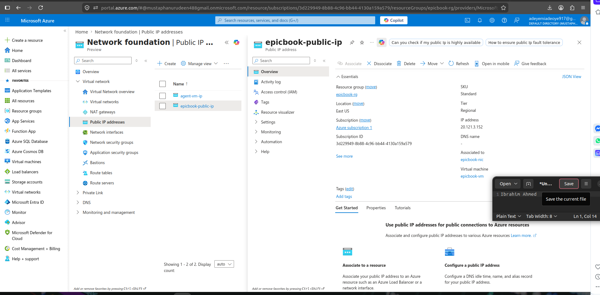

# EpicBook --- Azure DevOps CI/CD with Terraform and Ansible

A DevOps deployment exercise demonstrating how to provision Azure
infrastructure with **Terraform**, configure a Linux application server
with **Ansible**, and coordinate the workflow through **Azure DevOps
Pipelines**.

> **Evidence note:** The deployment screenshots below are from the
> supplied Week 13 Assignment 4 exercise material. The
> `azure-pipelines.yml` file was subsequently added to this repository,
> but that new YAML pipeline was **not executed** during this
> documentation update. The screenshots therefore document the original
> exercise execution; they are not proof that the newly added pipeline
> has run.

## Project information

  Item                  Details
  --------------------- ------------------------------------------------
  Application           EpicBook
  Programme             DevOps Micro Internship
  Assignment            Week 13 --- Assignment 4
  Group                 Group 2
  Source repository     `slim274/epicbook-terraform-ansible`
  CI/CD branch          `feat/azure-devops-cicd`
  Pipeline definition   [`azure-pipelines.yml`](./azure-pipelines.yml)

## Overview

The objective was to automate the deployment lifecycle: provision Azure
resources, prepare a Linux server, deploy the EpicBook Node.js
application, connect it to MySQL, and expose it through Nginx.

### Deployment flow

``` text
Azure DevOps Pipeline
        |
        v
Self-hosted Ubuntu Agent
        |
        +---- Terraform ----> Azure Resource Group
        |                       |
        |                       +-- Virtual Network and Subnet
        |                       +-- Network Security Group
        |                       +-- Public IP
        |                       +-- Network Interface
        |                       +-- Linux Virtual Machine
        |
        v
      Ansible
        |
        +-- Install server packages
        +-- Deploy EpicBook application
        +-- Configure MySQL
        +-- Configure Nginx reverse proxy
        |
        v
EpicBook (Node.js) + MySQL
        |
        v
Nginx / HTTP access
```

## Technology stack

  Technology        Role
  ----------------- -------------------------------------------------------
  Azure DevOps      Pipeline orchestration and execution
  Terraform         Infrastructure as Code for Azure resources
  Ansible           Linux server configuration and application deployment
  Microsoft Azure   Cloud infrastructure
  Ubuntu Linux      Self-hosted agent and application server environment
  Node.js           EpicBook application runtime
  MySQL             Application database (`bookstore`)
  Sequelize         Object Relational Mapper for MySQL
  Nginx             Reverse proxy to the Node.js application

## Implementation

### 1. Self-hosted Azure DevOps agent

Hosted parallelism was unavailable for the exercise, so an Ubuntu
virtual machine was configured as a self-hosted Azure DevOps agent.

The setup involved:

1.  Provisioning an Ubuntu Linux VM.
2.  Connecting to the VM over SSH.
3.  Downloading and installing the Azure Pipelines agent.
4.  Registering the agent with Azure DevOps using a Personal Access
    Token (PAT).
5.  Starting the agent so it could receive pipeline jobs.

### 2. Azure service connection

An App Registration was created in Microsoft Entra ID and used as a
Service Principal. Its credentials were used to configure an Azure
Resource Manager service connection in Azure DevOps.

This service connection provides the authentication path between the
pipeline and the Azure subscription. **Credentials and secret values are
intentionally excluded from this repository documentation.**

### 3. Terraform infrastructure provisioning

Terraform was used to define and provision the Azure infrastructure.

The configuration covered:

-   Azure Resource Group.
-   Virtual Network and Subnet.
-   Network Security Group with SSH (port 22) and HTTP (port 80) inbound
    rules.
-   Public IP address.
-   Network Interface.
-   Linux Virtual Machine.

The Terraform workflow used in the exercise was:

``` bash
terraform init
terraform plan
terraform apply -auto-approve
terraform output
```

`terraform init` initializes the working directory and downloads
providers. `terraform plan` previews the proposed changes.
`terraform apply` provisions the resources, and `terraform output`
displays exported values such as the VM public IP.

**Terraform execution evidence**


### 4. Azure infrastructure verification

After provisioning, the resources were checked in the Azure portal.

**Resource group**


**Linux virtual machine**


**Public IP address**



**Virtual network**


**Network interface**


### 5. Ansible server configuration and application deployment

Ansible automated the application-server setup and deployment tasks. The
exercise included:

-   Installing Node.js and npm.
-   Installing Git, MySQL and Nginx.
-   Cloning the EpicBook application repository.
-   Installing application dependencies with `npm install`.
-   Starting the Node.js application.
-   Configuring Nginx as a reverse proxy.

The original assignment material shows the command:

``` bash
ansible-playbook -i inventory.ini deploy.yml
```

**Repository note:** The current repository's Ansible entry point is
`ansible/site.yml`, and the added Azure pipeline references that
playbook. The command above is retained as shown in the original
assignment exercise.

**Ansible pipeline evidence**


The supplied Ansible execution screenshot reports 9 successful tasks, 8
changed tasks, and no unreachable or failed hosts.

### 6. Application and database configuration

The EpicBook application was deployed as a Node.js application.
Sequelize was used as the ORM for MySQL, and the application database
was named `bookstore`.

The exercise records the following configuration:

-   A dedicated MySQL account was created for application access.
-   The Node.js application listened on port `8080`.
-   Nginx forwarded incoming requests to the local Node.js service.

The reverse-proxy directive used was:

``` nginx
proxy_pass http://localhost:8080;
```

A dedicated database account was used instead of relying on the MySQL
root account. Passwords are not included in this README.

### 7. Application verification

The supplied exercise evidence records access to the application through
the Azure VM public IP:

``` text
http://20.121.3.152
```

The verification steps included:

1.  Confirming that the EpicBook interface loaded in a browser.
2.  Inserting book records into the database.
3.  Confirming that the application displayed dynamic book content.


## Azure DevOps pipeline added to this repository

The file [`azure-pipelines.yml`](./azure-pipelines.yml) was added to the
existing GitHub repository on the branch `feat/azure-devops-cicd`.

At a high level, the YAML defines:

-   A **Validate** stage for Terraform formatting, initialization and
    validation.
-   An opt-in **Deploy** stage, controlled by the `deployToAzure`
    parameter (default: `false`).
-   Azure authentication through the configured service connection.
-   Terraform deployment steps and execution of the repository's Ansible
    playbook.

The pipeline expects its Azure DevOps agent pool, service connection,
secure SSH files and pipeline variables to be configured in Azure
DevOps. Secret values should be stored in protected variables or secure
files, never committed to Git.

> **Current status:** The YAML definition is committed to the feature
> branch. It has not been run as part of this documentation activity,
> and its execution is not being claimed here.

## Challenges encountered and solutions

  -----------------------------------------------------------------------
  Challenge                           Resolution recorded in the exercise
  ----------------------------------- -----------------------------------
  Azure DevOps reported no hosted     Configured and registered a
  parallelism                         self-hosted Ubuntu agent.

  Terraform requested `az login`      Configured a Service Principal and
                                      Azure DevOps service connection.

  Requested VM size was unavailable   Selected a VM size supported in the
  (`SkuNotAvailable`)                 Azure region.

  Public IP allocation issue          Used the Standard public IP SKU.

  Ansible SSH issues (`sshpass`       Installed `sshpass` and disabled
  missing / host key verification)    host-key checking for the relevant
                                      exercise connection workflow.

  Nginx returned `502 Bad Gateway`    Started the Node.js application and
                                      corrected the backend port to
                                      `8080`.

  MySQL denied access for `root`      Created a dedicated application
                                      database user and granted the
                                      required database privileges.

  Application displayed no book data  Inserted sample records and
                                      verified that dynamic content
                                      appeared.
  -----------------------------------------------------------------------

## Final outcome recorded by the assignment

The supplied Week 13 exercise evidence records that:

-   Azure infrastructure was provisioned.
-   The Linux application server was configured using Ansible.
-   The EpicBook application was deployed.
-   MySQL was integrated with the application.
-   Nginx was configured as a reverse proxy to the Node.js service.
-   The application interface and book listings were accessible through
    the VM public IP.

The pipeline YAML was also added to the existing GitHub repository as a
separate source-control update; it has not yet been executed.

## Repository structure

Relevant project files include:

``` text
epicbook-terraform-ansible/
├── ansible/
│   ├── site.yml
│   ├── inventory.ini.example
│   └── roles/
├── terraform/
│   └── azure/
├── docs/
│   └── screenshots/
│       └── week13/
├── azure-pipelines.yml
└── README.md
```

## Security considerations

-   Do not commit Azure client secrets, passwords, private SSH keys,
    Terraform state files or other credentials.
-   Store pipeline secrets in protected Azure DevOps variables or secure
    files.
-   Restrict SSH access to trusted source IP addresses.
-   Rotate any real credential that may have been exposed in a shared
    document, terminal log or repository.
