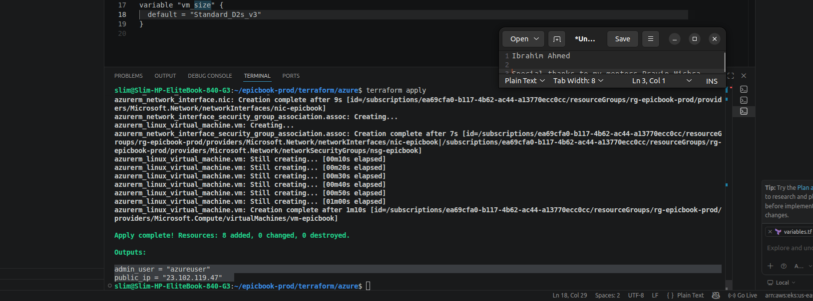
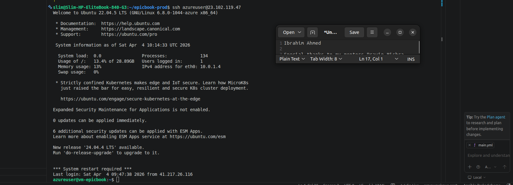
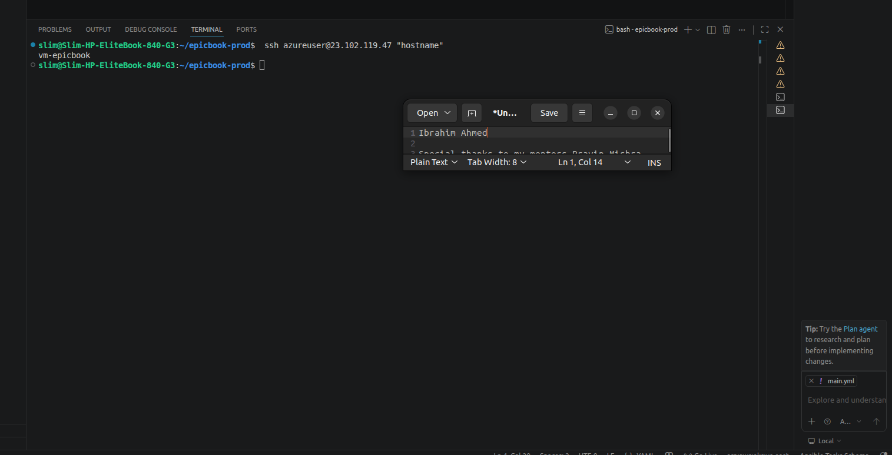
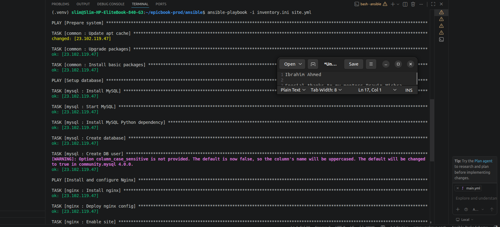
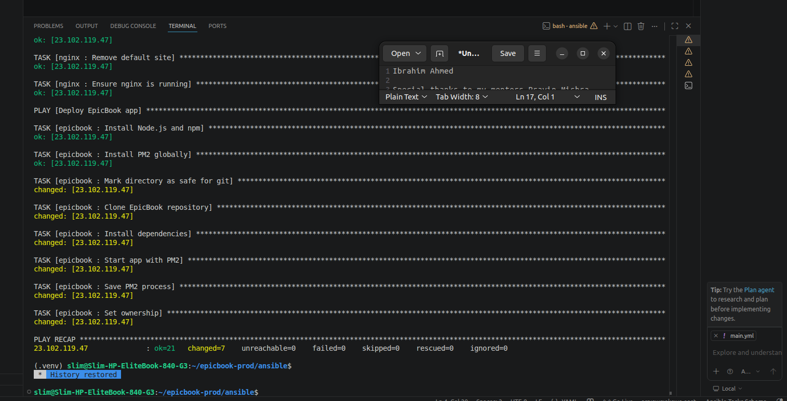
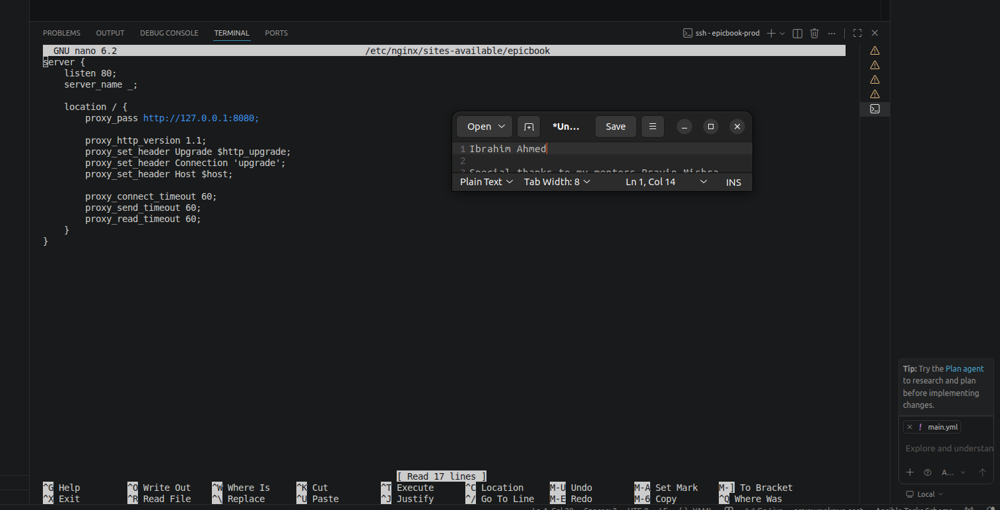
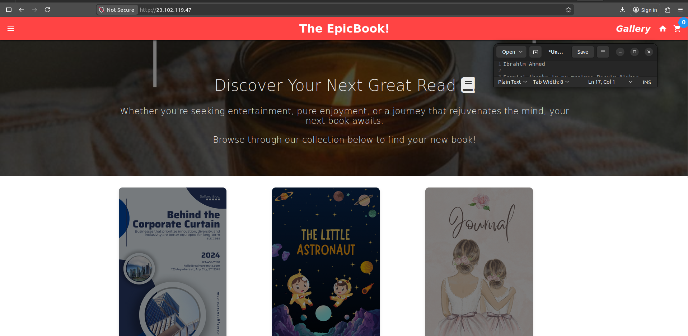
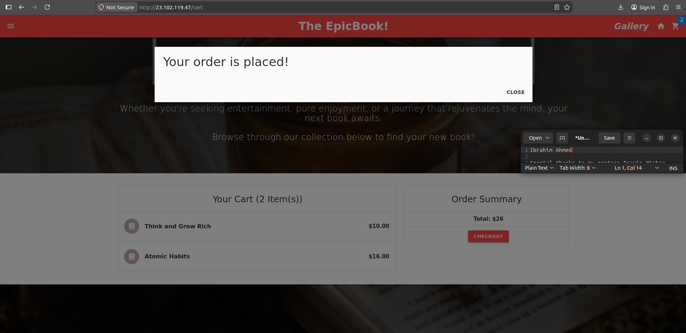

## Deployment Screenshots

The following screenshots are extracted from the submitted Week 12 EpicBook assignment. They show the Terraform deployment, SSH access, Ansible execution, Nginx reverse-proxy configuration, and the application running in a browser.

### Terraform provisioning

### Passwordless SSH

### Ansible deployment

### Nginx reverse proxy

### EpicBook application

